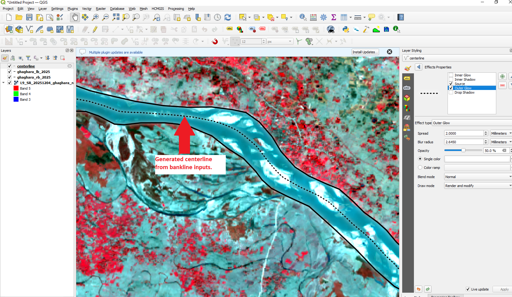
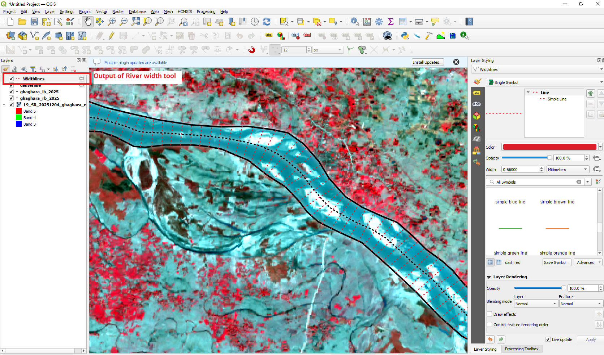
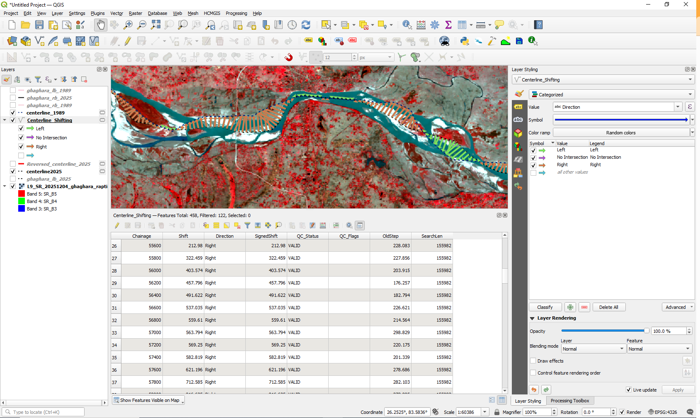
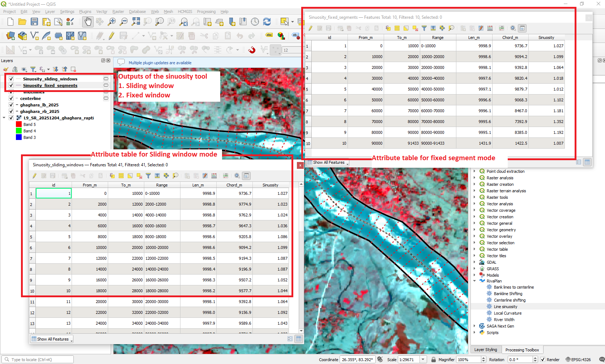
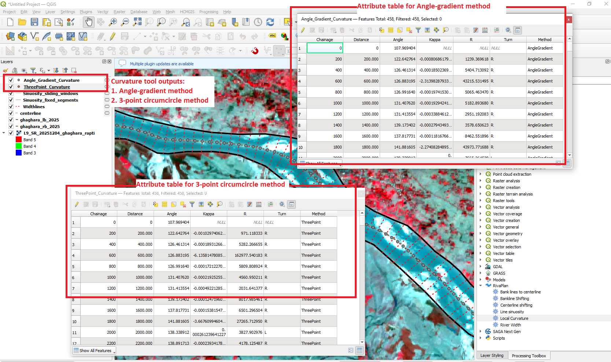

  

<h1 align="center">RivaPlan</h1>

  <b>An automated QGIS toolbox for river planform morphology analysis</b>

---

## About RivaPlan

**RivaPlan** is an open-source QGIS Processing plugin developed for automated and reproducible analysis of river planform morphology from vector river-bank data.

The plugin integrates seven tools for generating representative river centerlines, reversing line direction, and quantifying river width, bankline migration, centerline migration, sinuosity, and local curvature.

RivaPlan is designed to reduce repetitive GIS operations and provide a consistent workflow for river morphology and channel-change analysis within the QGIS environment.

---

## RivaPlan in QGIS

After installation, RivaPlan is available as a dedicated processing provider within the **QGIS Processing Toolbox**, providing seven tools for river planform morphology analysis. The seven-tool release is version **2.1.0**.

  

---

## Tools Available in RivaPlan

| Tool | Description |
|---|---|
| **Bank lines to centerline** | Generates a representative corridor centerline from paired, continuous outer banklines using Voronoi geometry and shortest-path tracing. |
| **Reverse Line Direction** | Reverses the vertex order of any line feature without changing its geometry or attributes; users independently verify downstream direction. |
| **River Width** | Measures widths between opposing bankline intersections along centerline-based perpendicular transects. |
| **Bankline Shifting** | Measures historical-to-recent displacement of a selected bank and reports downstream-relative direction, inward/outward adjustment, and QC flags. |
| **Centerline shifting** | Measures displacement of the newer centerline relative to the older centerline, with direction and QC flags. |
| **Line sinuosity** | Computes sinuosity using fixed segments or sliding windows and flags incomplete terminal windows. |
| **Local Curvature** | Estimates signed curvature using angle-gradient and/or three-point circumcircle methods. |

---

## Installation

RivaPlan is distributed through the **official QGIS Plugin Repository**. The seven-tool version **2.1.0** is being prepared for release; until it is published, the repository may provide an earlier version.

### Install directly from QGIS

1. Open **QGIS**.
2. Go to **Plugins → Manage and Install Plugins**.
3. Search for **RivaPlan**.
4. Select **RivaPlan**.
5. Click **Install Plugin**.
6. Open the **Processing Toolbox**.
7. The RivaPlan algorithms will appear under the **RivaPlan** processing provider.

> **Note:** RivaPlan is currently distributed as an experimental plugin. If it does not appear in the Plugin Manager, enable the option to display experimental plugins.

---

## General Workflow

A typical RivaPlan workflow consists of:

1. Prepare the river banklines.
2. Generate the river centerline from opposing outer banks.
3. Verify its downstream orientation; optionally use **Reverse Line Direction** if the vertex order needs reversal.
4. Calculate river width and/or bankline and centerline shifting.
5. Calculate line sinuosity and local curvature.

The individual RivaPlan algorithms can also be used independently depending on the requirements of the analysis.

---
## Example Outputs

### River Centerline Generation

RivaPlan generates a representative river centerline from the supplied left and right banklines.

  

### Reverse Line Direction

The tool reverses the input line vertex order while preserving its shape, attributes and CRS. It does **not** infer upstream or downstream direction. Verify flow direction independently before using chainage-dependent tools.

### River Width

Channel-width transects are generated at user-defined chainage intervals along the river centerline.

  

### Channel Shifting

RivaPlan quantifies lateral river migration using bankline and centerline shifting tools.

  

### Sinuosity

Sinuosity can be analysed using fixed segments or sliding analysis windows.

  

### Local Curvature

Local curvature can be estimated using the angle-gradient and three-point circumcircle approaches.

  

---

## Input Data and Quality Checks

- Distance-based analysis requires a **projected working CRS with metre units**. Use the optional working CRS setting where offered.
- Centerline generation requires a valid, continuous left and right bankline enclosing a single analysis corridor. Input layers and coordinate systems are validated before processing.
- For multi-thread rivers, outer channel-corridor boundaries can be supplied, including internal bars and branches within the corridor. The resulting centerline represents the **overall corridor**, not individual channels or internal bar boundaries.
- Verify which end of the reference centerline is downstream. When a downstream-oriented reference is used, chainage increases downstream and geometric shifting directions are defined looking downstream.
- In the migration tools, **SHARP_BEND**, **SHIFT_SPIKE**, and **IRREGULAR_PROGRESSION** identify potentially non-representative measurements. Flags are diagnostic; flagged valid measurements are retained for review. Bankline progression is evaluated separately along older and newer banklines.
- Bankline shifting additionally distinguishes downstream-left/right signed displacement from inward/outward bank adjustment. These geometric adjustments do not by themselves establish erosion or deposition.
- For detailed parameter validation, restrictions and output statuses, consult each algorithm's help text.

---

## Sample Data

Example datasets for testing RivaPlan are provided in the `sample_data/` directory.

---

## Software Requirements and Compatibility

RivaPlan v2.1.0 is implemented in Python/PyQGIS and runs within the QGIS Processing framework. The seven tools were functionally tested in **QGIS 3.40.13 (Bratislava)** on Windows. The recorded development environment includes the following software versions:

| Component | Recorded test environment |
|---|---|
| QGIS | 3.40.13 (Bratislava) |
| Python | 3.12.12 |
| GDAL | 3.12.0 |
| GEOS | 3.13.1 |

These values describe the recorded environment, **not verified minimum compatible versions**. Confirm the installed dependency versions before release. The `qgisMinimumVersion=3.28` value in `metadata.txt` is a declared minimum; compatibility with QGIS 3.28 and other QGIS versions has not been independently verified. Linux and macOS compatibility also remain to be tested.

Distance-based calculations require an appropriate projected working CRS with metre units. Reverse Line Direction uses the built-in QGIS reverse-line-direction Processing algorithm and requires no DEM or internet connection.

## Known Limitations

The centerline generator requires two continuous, nonintersecting bankline boundaries describing one corridor. It does not independently map internal braid threads, islands, branching connectivity or individual bar margins. Large datasets and dense bankline sampling may increase processing time and memory use. Direction correction does not automatically determine flow direction. Migration flags highlight cases for manual inspection; they are not proof of erroneous measurements.

## Testing

All **seven tools**, including the new **Reverse Line Direction**, have been tested manually in QGIS. A reproducible suite of **16 synthetic-data regression checks passed (16/16)**, both in the QGIS Python Console and through the standalone QGIS Python launcher on Windows. The checks cover:

- Registration of all seven algorithms; line reversal and attribute preservation.
- River width and centerline generation for simple synthetic channels.
- Centerline and bankline displacement signs, including outward bank adjustment on both banks.
- Fixed and sliding-window sinuosity, incomplete terminal windows, and zero curvature on straight lines.
- Geographic-CRS input rejection, QC parameter validation, and examples of `SHARP_BEND`, `SHIFT_SPIKE`, and `IRREGULAR_PROGRESSION` flags.

The test scripts and standalone runner are in [`tests/`](tests/). These results describe **16 successful regression checks**, not a measured code-coverage percentage. GitHub Actions workflow configuration is in `.github/workflows/`; its Linux execution status must be verified on GitHub before claiming continuous integration is passing. No multi-version QGIS compatibility matrix has yet been established.