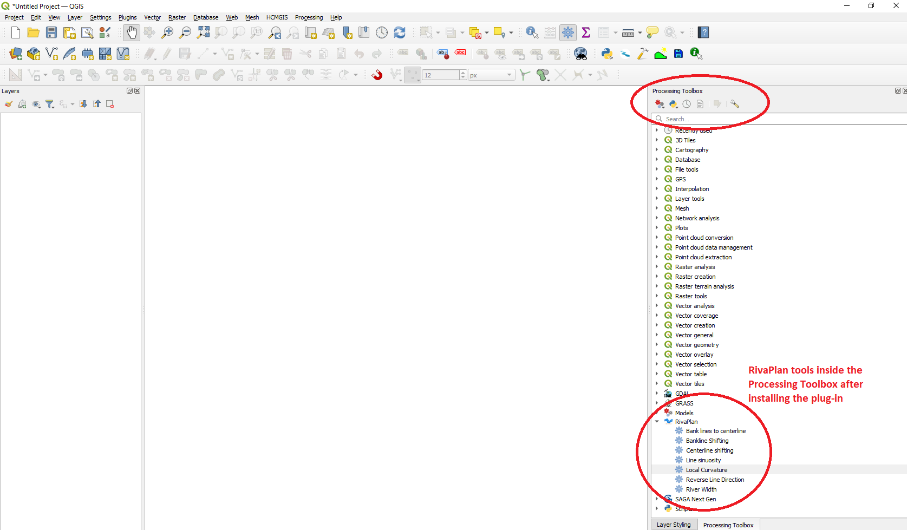
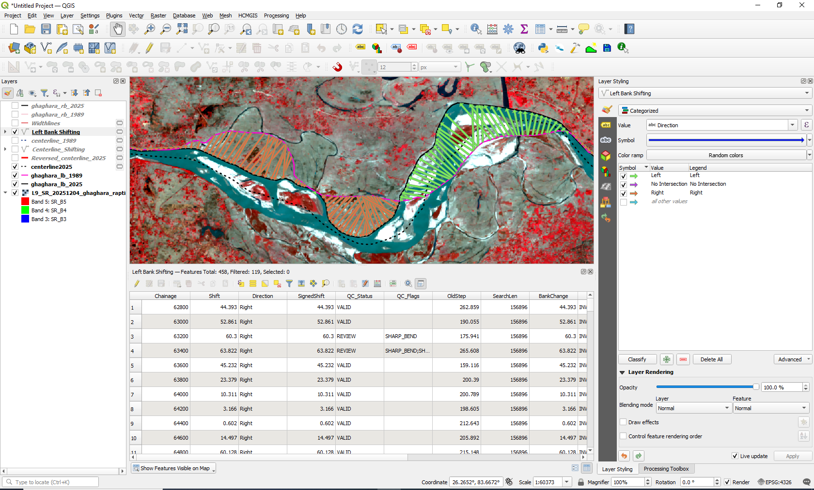
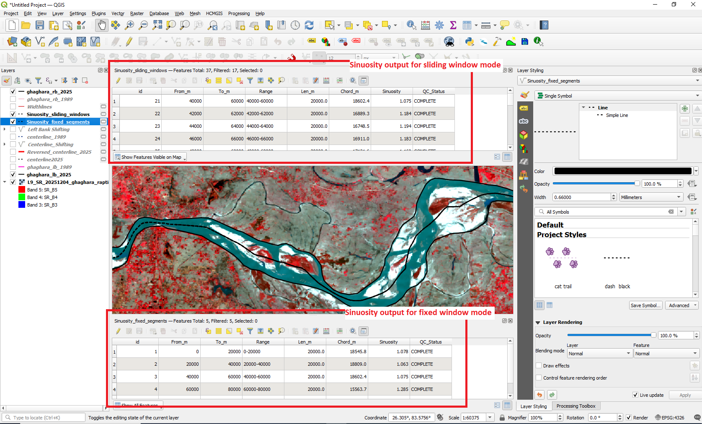
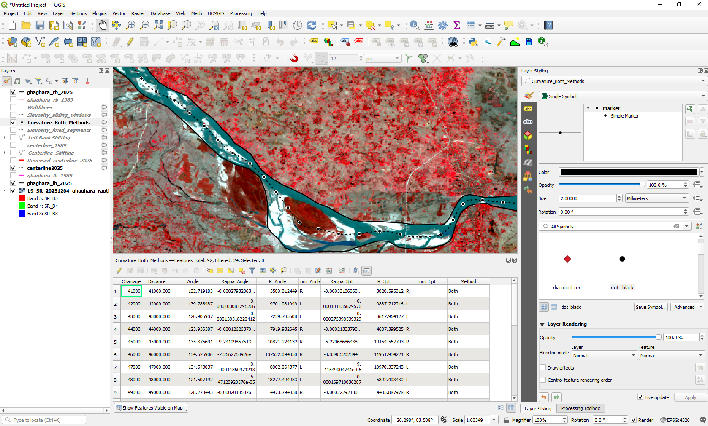

  

<h1 align="center">RivaPlan</h1>

<strong>An open-source QGIS Processing toolbox for river planform morphology analysis</strong>

  <a href="https://plugins.qgis.org/plugins/Planform_Morphology/">QGIS Plugin Repository</a> ·
  <a href="docs/README.md">Documentation</a> ·
  <a href="sample_data/">Sample data</a> ·
  <a href="https://github.com/Rohit-Sharma-21/RivaPlan/issues">Report an issue</a>

> **Development status:** Experimental. The v2.1.1 documentation and centerline changes are under preparation and require final testing and repository submission. The version available in the QGIS Plugin Repository may differ from the latest GitHub source. Consult the [official plugin listing](https://plugins.qgis.org/plugins/Planform_Morphology/) for the currently approved version.

## About RivaPlan

**RivaPlan** is a Python/PyQGIS plugin that provides seven Processing tools for post-digitization river planform analysis. It generates a representative centerline from two opposing continuous banklines and measures river width, centerline and bankline displacement, sinuosity, and local curvature. An additional tool reverses line vertex order when a user needs to correct the direction of an input line.

The tools are intended primarily for **river-reach and outer-corridor analyses**. For braided or multithread rivers, two outer banklines may enclose internal bars and secondary threads; the generated centerline characterizes the overall corridor, **not** the individual threads.

## RivaPlan in QGIS

  

## Seven Processing tools

| Tool | Purpose | Documentation |
|---|---|---|
| **Bank lines to centerline** | Build one centerline from paired banklines using a filtered Voronoi graph and Dijkstra shortest path. | [Inputs, advanced parameters and output](docs/centerline.md) |
| **Reverse Line Direction** | Reverse line vertex order while retaining geometry and attributes; does not determine flow direction. | [Inputs and output](docs/reverse_line_direction.md) |
| **River Width** | Measure channel widths along perpendicular transects and flag unresolved intersections. | [Inputs, search settings and output](docs/width.md) |
| **Centerline shifting** | Measure old-to-new centerline displacement using the newer centerline as the chainage reference and report QC flags. | [Inputs, QC and output](docs/centerline_shifting.md) |
| **Bankline Shifting** | Quantify bank displacement, downstream-relative direction, inward/outward movement and QC conditions. | [Inputs, QC and output](docs/bankline_shifting.md) |
| **Line sinuosity** | Measure centerline-length/chord ratios using fixed segments or sliding windows. | [Modes, parameters and output](docs/sinuosity.md) |
| **Local Curvature** | Estimate curvature using angle-gradient, three-point circumcircle or both methods. | [Methods, sampling and output](docs/curvature.md) |

Each linked guide includes a tool-interface screenshot, input/output explanations, parameter descriptions and an example result.

## Installation

### From the QGIS Plugin Repository

1. Open QGIS and choose **Plugins → Manage and Install Plugins**.
2. Open **Settings** and enable **Show also experimental plugins**.
3. Search for **RivaPlan** and install the available approved version.
4. Open **Processing → Toolbox** and expand the **RivaPlan** provider.

### From the GitHub source code (for development/testing)

1. Download or clone this repository.
2. Copy the plugin package files into a folder named **`Planform_Morphology`** under your active QGIS profile's `python/plugins/` directory. The package folder must contain `__init__.py`, `metadata.txt`, `main.py`, `provider.py`, and the algorithm modules.
3. Restart QGIS, enable **RivaPlan** in the Plugin Manager, and open the Processing Toolbox.

Do **not** copy the entire Git repository (including `.git`, `docs` and `tests`) as an additional nested folder inside the plugin package. For an official release, use the ZIP provided via the QGIS repository.

## System requirements

- **QGIS:** metadata declares a minimum version of **3.28**; this is a declared requirement, **not a verified compatibility guarantee**.
- **Processing framework:** enabled in QGIS; uses QGIS Processing and PyQGIS.
- **Operating system:** manually tested on Windows; the previous seven-tool codebase also passed automated tests in an Ubuntu GitHub Actions environment. macOS and a full cross-version compatibility matrix have not been independently validated.
- **Coordinate systems:** use a suitable **projected working CRS with metre units** for distance-based measurements. The centerline algorithm rejects geographic and non-metre working CRSs.

Recorded Windows test environment for the preceding seven-tool implementation: **QGIS 3.40.13, Python 3.12.12, GDAL 3.12.0 and GEOS 3.13.1**. These are recorded test versions, not minimum dependencies. Final regression and functional tests of the new v2.1.1 centerline changes are pending.

## Quick start: from banklines to a centerline and width measurements

1. Open QGIS and load the **left-bank** and **right-bank** vector layers for the **same river reach**. Example data are described under [`sample_data/`](sample_data/); check the dataset README before selecting files.
2. Verify that each bank is one continuous, valid, nonintersecting line feature and that their endpoints bound the intended river corridor. Choose an appropriate projected CRS in metres.
3. Open **Processing Toolbox → RivaPlan → Bank lines to centerline** and select the two bank layers.
4. Expand **Advanced Parameters**. The **Bankline densification interval** defaults to **5 m**; **Bank-exclusion buffer distance** defaults to **0.50 m**. For narrow or highly sinuous channels, a smaller positive exclusion distance may preserve Voronoi connections, but inspect the result and processing log. Set the output location and run.
5. Inspect the resulting centerline against the riverbanks. Review any processing warnings, including centerline/bank crossing or outside-corridor diagnostics. Confirm upstream/downstream direction; use **Reverse Line Direction** if vertex order must be reversed.
6. Open **River Width**, choose the same left and right banks plus the generated centerline, select a suitable chainage interval and create width transects. Check flagged or missing widths before analysis.
7. If historical data are available, run **Centerline shifting** or **Bankline Shifting** using correctly matched time periods. For sinuosity and curvature, use the centerline directly.

Detailed explanations, field definitions and advanced settings are in the [tool documentation](docs/README.md).

## Screenshots and example outputs

### Centerline generation

### Reverse Line Direction

The reversal changes vertex order, **not** the line shape or thickness. Direction arrows in the visualization indicate the stored vertex order, not necessarily water flow direction.

### River Width

### Centerline shifting

### Bankline Shifting

### Line sinuosity

### Local Curvature

The corresponding **interface screenshots**, including advanced settings, are provided in the individual [tool guides](docs/README.md).

## Input preparation and quality control

- **Centerline inputs:** each bank layer must contain exactly one continuous line feature; boundaries must be distinct and nonintersecting, with end caps able to form a valid polygon. The algorithm represents a single analysis corridor, not a complete branching river network.
- **CRS:** use a projected working CRS in **metres**. Avoid running distance calculations directly in latitude/longitude.
- **Reference direction:** left/right displacement signs assume a consistently oriented downstream reference line. Verify flow direction independently; Reverse Line Direction does not infer downstream.
- **Ambiguous intersections:** width and migration measures can be affected by very sharp bends, multiple crossings or incomplete boundaries. Review `NO_WIDTH` and migration QC indicators rather than automatically treating all outputs as reliable.
- **Migration QC:** `SHARP_BEND`, `SHIFT_SPIKE` and `IRREGULAR_PROGRESSION` identify measurements meriting inspection; they do not automatically prove an observation incorrect. Bankline outward/inward status describes geometric adjustment, **not** directly verified erosion or deposition.

## Sample datasets

The [`sample_data/`](sample_data/) directory contains example resources. Documentation for **Rapti**, **Ghaghara** and the nine synthetic configurations **S01–S09** will be expanded as the new datasets are added and verified. Do not assume that every named dataset is available until its files and associated README have been committed.

The synthetic configurations span straight, variable-width and meandering cases. Their known reference centerlines will be identified distinctly from centerlines generated by RivaPlan so users can reproduce the validation exercises.

## Known limitations and development status

RivaPlan is currently **experimental**. In particular:

- The centerline tool expects **two continuous bank boundaries** for **one corridor**; it does not automatically delineate complex networks, internal braid threads, islands or branching connectivity.
- A successful centerline depends on input geometry and on a sufficiently connected, bank-filtered Voronoi network. Narrow or tightly curving reaches can require parameter tuning and manual output checks; some inputs may not yield a connected route.
- Processing time and memory requirements increase with bankline length, vertex density, densification and geometric complexity. **No validated maximum number of vertices, maximum reach length or maximum network size has been established.**
- Displacement, width and curvature calculations are geometry- and sampling-dependent. QC flags require expert review; geometric bank changes do not independently establish sediment erosion/accretion.
- Compatibility with every QGIS release and operating system has not been established. Further real-world and synthetic case testing is ongoing.

## Testing and reproducibility

The earlier v2.1.0 seven-tool implementation passed **16 automated regression checks** in Windows QGIS and an Ubuntu GitHub Actions run. These cover registration, selected geometric operations, direction conventions, input validation and QC behaviour. See [`tests/`](tests/) and [the workflow](.github/workflows/tests.yml). The suite does **not** establish complete coverage, and it must be rerun after the new adjustable-buffer centerline code is incorporated for v2.1.1.

For bugs, enhancement requests or reproducibility questions, please [open a GitHub issue](https://github.com/Rohit-Sharma-21/RivaPlan/issues) and include the QGIS version, CRS, algorithm settings, processing log and a small reproducible input dataset when possible.

## Documentation, license and citation

- [Documentation index and seven tool guides](docs/README.md)
- [Sample data](sample_data/)
- [Changelog](CHANGELOG.md)
- [License](LICENSE)
- [Citation metadata](CITATION.cff)
- [Official QGIS plugin listing](https://plugins.qgis.org/plugins/Planform_Morphology/)

**Developer:** Rohit Sharma · **Contact:** r_sharma@ce.iitr.ac.in

**Research supervision and methodological contributions:** Prof. Zulfequar Ahmad and Prof. Rahul Dev Garg.
