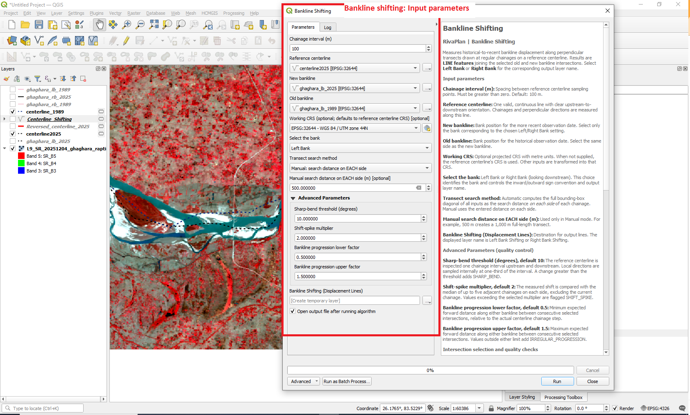
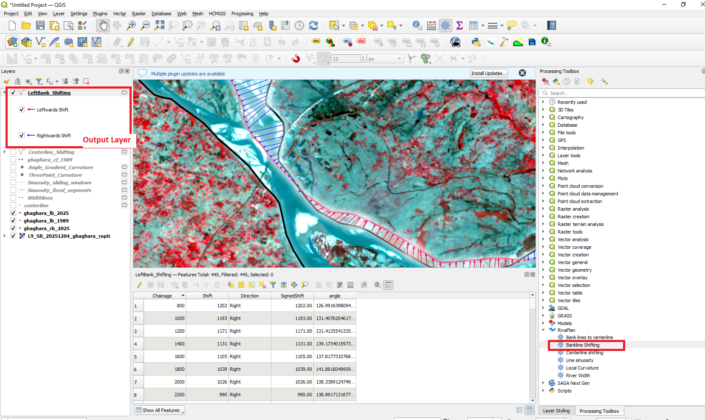

# Bankline Shifting

The **Bankline Shifting** tool quantifies lateral migration between river banklines from two different time periods.

The analysis uses regularly spaced chainage points along a reference centerline and perpendicular transects to identify corresponding positions on the old and new banklines.

---

## Tool Location

In QGIS, open:

**Processing Toolbox → RivaPlan → Bankline Shifting**

---

## Input Parameters

| Parameter | Description |
|---|---|
| **Chainage Interval** | Distance between consecutive measurement locations along the centerline. The default value is 100 m. |
| **Centerline** | Reference river centerline used for generating chainage points and perpendicular transects. |
| **New Bank Line** | Bankline representing the more recent time period. |
| **Old Bank Line** | Bankline representing the earlier time period. |
| **Working CRS (projected)** | Projected coordinate reference system used for distance calculations. |
| **Select the Bank** | Specifies whether the analysis represents the Left Bank or Right Bank. |
| **Bankline Shifting** | Output point layer containing bankline-shifting measurements. |

A projected CRS with metric units is recommended.

---

## Tool Interface

  

---

## Method

Bankline shifting is calculated through the following workflow:

1. The centerline, old bankline, and new bankline are reprojected to the selected working CRS.

2. Chainage points are generated along the centerline at the user-defined interval.

3. Perpendicular transects are generated at the chainage locations.

4. Each transect is intersected with the new bankline.

5. If multiple intersections occur for a chainage, the intersection closest to the corresponding centerline point is retained.

6. The same procedure is applied to the old bankline.

7. Distances are calculated between:
   - the centerline and old bankline,
   - the centerline and new bankline, and
   - the old and new bankline positions.

8. The distance between the old and new bankline positions represents the magnitude of bankline shifting.

9. The selected bank orientation is used to determine whether the shift occurred toward the left or right side.

10. A signed shifting value is generated to allow directional changes to be analysed quantitatively.

---

## Output

The final output is a point layer containing bankline-shifting measurements at the chainage locations.

  

Important output attributes include:

| Attribute | Description |
|---|---|
| **Chainage** | Distance along the reference centerline. |
| **angle** | Local orientation associated with the centerline chainage location. |
| **Shift** | Magnitude of lateral displacement between the old and new banklines. |
| **Direction** | Direction of movement: Left, Right, or No Shift. |
| **SignedShift** | Directional shifting value. Left shifts are negative and right shifts are positive. |

---

## Selecting Left or Right Bank

The **Select the Bank** parameter is important because the geometric interpretation of leftward and rightward movement depends on which bank is being analysed.

Available options are:

- **Left Bank**
- **Right Bank**

The old and new banklines supplied to the tool should therefore represent the same side of the river.

---

## Chainage Interval

The chainage interval controls the spatial spacing of migration measurements.

For example:

- `50 m` produces measurements approximately every 50 m.
- `100 m` produces measurements approximately every 100 m.

Smaller intervals provide greater spatial detail but generate more measurement points.

---

## Input Data Recommendations

For reliable bankline-shifting analysis:

- The old and new banklines should represent the same river bank.
- Use a centerline corresponding to the analysed river reach.
- Ensure that the datasets cover approximately the same longitudinal extent.
- Correct major geometry or topology errors before processing.
- Use a projected CRS with metre-based units where possible.
- Use a chainage interval appropriate for the scale and sinuosity of the river.

---

## Notes

Where multiple bankline intersections occur along a transect, RivaPlan retains the intersection nearest to the corresponding centerline chainage point.

Intermediate layers are temporary and only the final bankline-shifting layer is returned as the primary output.