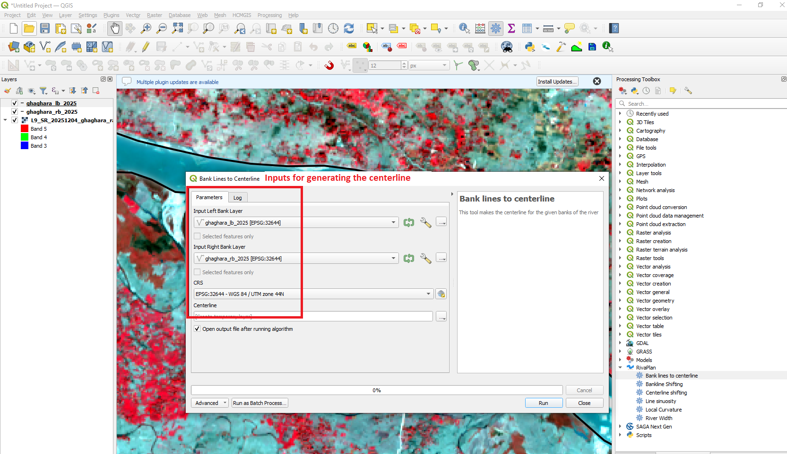
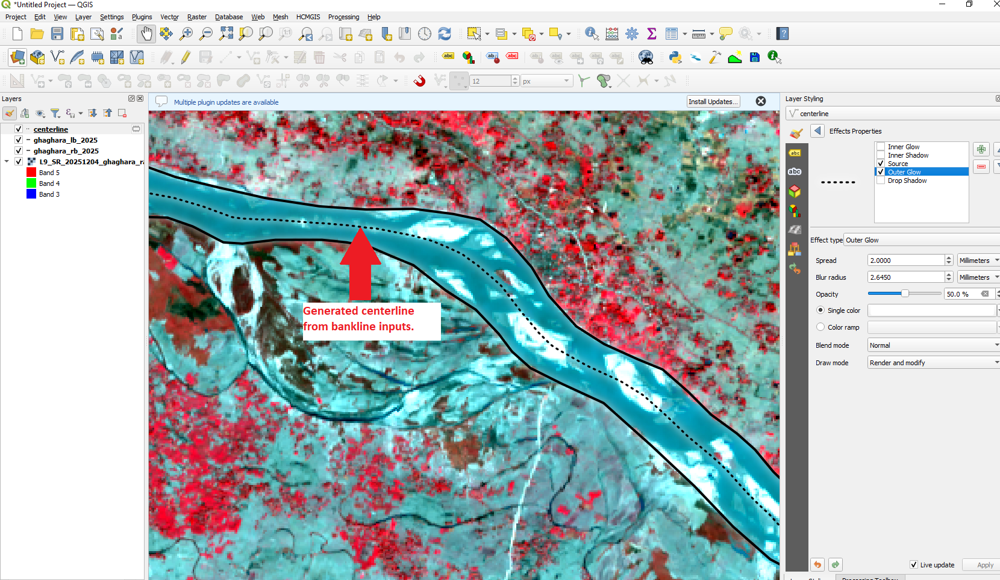

# Centreline Generation

The **Bank lines to centerline** tool generates a representative river centreline from paired left and right river-bank polylines.

The algorithm constructs a river-channel polygon from the two banklines and derives a continuous centreline through a filtered Voronoi network.

---

## Tool Location

In QGIS, open:

**Processing Toolbox → RivaPlan → Bank lines to centerline**

---

## Input Parameters

| Parameter | Description |
|---|---|
| **Input Left Bank Layer** | Polyline representing one river bank. |
| **Input Right Bank Layer** | Polyline representing the opposite river bank. |
| **CRS** | Projected coordinate reference system used during processing. |
| **Centerline** | Output vector layer containing the generated river centreline. |

A projected CRS is recommended because the algorithm uses distance-based geometric operations.

---

## Tool Interface

  

The user supplies the left and right bankline layers, selects an appropriate projected CRS, and defines the output centreline layer.

---

## Method

The centreline is generated through the following automated workflow:

1. The first and last vertices of both river banks are extracted.

2. The four bank endpoints are paired to form two end caps using the combination that minimizes the total connection distance.

3. The two banklines and end caps are combined to form a closed river-channel polygon.

4. The river banklines are densified internally at a **5 m interval**.

5. Voronoi polygons are generated from the densified bank vertices and converted to Voronoi line segments.

6. The Voronoi network is clipped to the river-channel polygon.

7. Voronoi segments located immediately adjacent to the banklines are filtered from the network using an internal **0.50 map-unit bank-exclusion distance**.

8. The remaining Voronoi segments are converted into an undirected graph in which segment length represents traversal cost.

9. The graph nodes nearest to the midpoints of the two end caps are selected as the start and end nodes.

10. **Dijkstra's shortest-path algorithm** is used to identify one continuous route through the filtered Voronoi network.

11. The resulting route is exported as the final river centreline.

---

## Output

The tool produces a vector line representing the generated river centreline.

  

The generated centreline can subsequently be used as input for other RivaPlan tools, including:

- River Width
- Centreline Shifting
- Sinuosity
- Local Curvature

---

## Input Data Recommendations

For reliable centreline generation:

- Use continuous left and right banklines covering approximately the same river reach.
- Both banklines should have identifiable upstream and downstream endpoints.
- Major geometry or topology errors should be corrected before processing.
- A projected CRS should be used.
- Metric CRS units are recommended when working with river dimensions in metres.
- Banklines should represent the opposing channel margins rather than disconnected channel fragments.

---

## Notes

The **5 m bank densification interval** and **0.50 map-unit bank-exclusion distance** are currently fixed internal parameters and do not require user input.

Intermediate processing layers are generated as temporary QGIS layers, while only the final centreline is returned as the primary output.