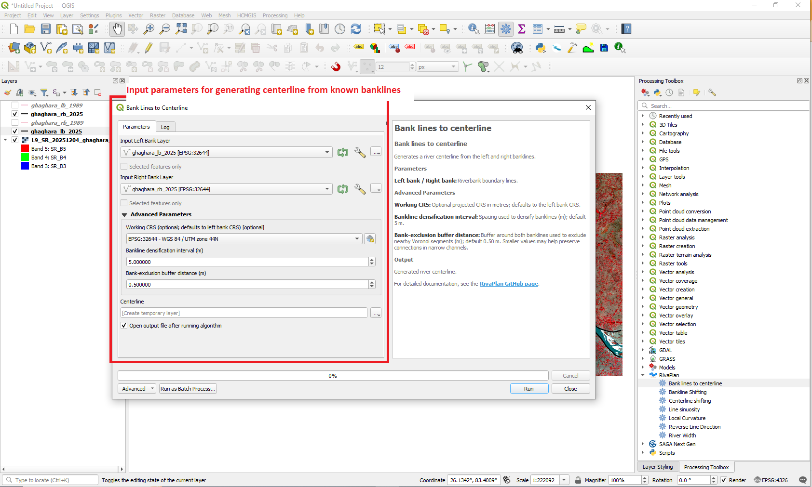

# Centerline Generation

The **Bank lines to centerline** tool generates a representative river centerline from paired left and right river-bank polylines.

The algorithm constructs a river-channel polygon from the two banklines and derives a continuous centerline through a filtered Voronoi network.

---

## Tool Location

In QGIS, open:

**Processing Toolbox → RivaPlan → Bank lines to centerline**

---

## Input Parameters

| Parameter | Description |
|---|---|
| **Input Left Bank Layer** | Polyline representing one river bank. |
| **Input Right Bank Layer** | Polyline representing the opposite river bank. |
| **Working CRS (advanced)** | Optional projected CRS in metres; defaults to left bank CRS. |
| **Bankline densification interval (advanced)** | Spacing in metres for adding bank vertices; default **5 m**, adjustable (positive value). |
| **Bank-exclusion buffer distance (advanced)** | Dissolved buffer around the two banks used to filter nearby Voronoi segments; default **0.50 m**, adjustable (positive value). |
| **Centerline** | Output vector line layer containing the generated river centerline. |

A **projected working CRS with metre units is required**. Each bank input must contain exactly **one continuous line feature**; the banklines must not intersect or overlap. Inputs with different CRSs are reprojected to the selected working CRS.

---

## Tool Interface

  

Supply one continuous left and right bankline feature, select the output, and expand **Advanced Parameters** to adjust working CRS, densification and bank-exclusion distance. For narrow channels with network disconnections, testing a smaller positive exclusion distance may help, but successful reconstruction is not guaranteed.

---

## Method

The centerline is generated through the following automated workflow:

1. The first and last vertices of both river banks are extracted.

2. The four bank endpoints are paired to form two end caps by evaluating geometrically valid cross-bank pairings and selecting the shortest valid combination.

3. The two banklines and end caps are combined to form a closed river-channel polygon.

4. The river banklines are densified at the **user-selected spacing (5 m default)**.

5. Voronoi polygons are generated from the densified bank vertices and converted to Voronoi line segments.

6. The Voronoi network is clipped to the river-channel polygon.

7. Voronoi segments located immediately adjacent to the banklines are filtered from the network using an a **user-selected bank-exclusion buffer (0.50 m default)**; a single dissolved buffer covers both banks.

8. The remaining Voronoi segments are converted into an undirected graph in which segment length represents traversal cost.

9. The graph nodes nearest to the midpoints of the two end caps are selected as the start and end nodes.

10. **Dijkstra's shortest-path algorithm** is used to identify one continuous route through the filtered Voronoi network.

11. The resulting route is exported as the final river centerline.

---

## Output

The tool produces a vector line representing the generated river centerline.

  

The generated centerline can subsequently be used as input for other RivaPlan tools, including:

- River Width
- Centerline Shifting
- Sinuosity
- Local Curvature

---

## Input Data Recommendations

For reliable centerline generation:

- Use continuous left and right banklines covering approximately the same river reach.
- Both banklines should have identifiable upstream and downstream endpoints.
- Major geometry or topology errors should be corrected before processing.
- A projected CRS should be used.
- Metric CRS units are recommended when working with river dimensions in metres.
- Banklines should represent the opposing channel margins rather than disconnected channel fragments.

---

## Notes

The **5 m densification interval** and **0.50 m bank-exclusion buffer distance** are editable **advanced parameters**, not fixed constants. More closely spaced vertices generally increase the Voronoi processing load. Very large buffer distances may disconnect the usable Voronoi network.

Intermediate processing layers are generated as temporary QGIS layers, while only the final centerline is returned as the primary output.

## Additional processing checks and limitations

- The tool evaluates the two cross-bank end-cap pairings and rejects invalid closures. For strongly folded reaches, inspect any end-cap warning in the processing log.
- Voronoi segments are clipped to the constructed channel polygon, filtered against the bank-exclusion buffer, and connected through a length-weighted undirected graph. Dijkstra's algorithm traces an ordered start-to-end line.
- Processing logs report timings for preprocessing, Voronoi filtering, graph construction and route extraction. Diagnostics warn if the final route lies outside the selected polygon or crosses a bank.
- The centerline represents **one analysis corridor**. Braided rivers can be analysed using their two outer boundaries, but internal anabranches are not separately extracted. The tool does not automatically segment entire river networks.
- The maximum supported number of vertices has **not** been established. Runtime and memory use depend on reach length, geometry and densification. Always inspect the resulting line in difficult bends.
- QGIS may produce a disconnected Voronoi network if geometry is unsuitable or too much linework is removed by the buffer; in that case the algorithm reports that no connected route was found.

[Return to tool documentation](README.md)
