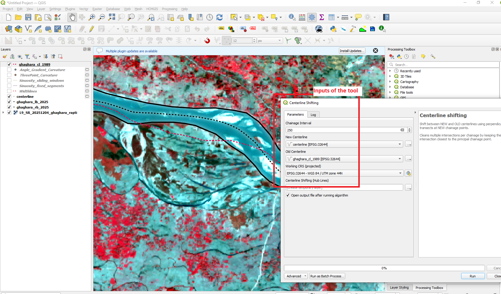
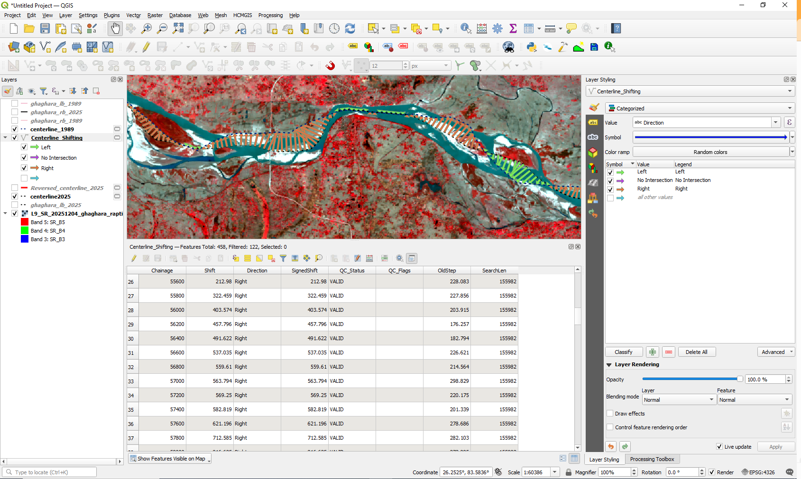

# Centerline Shifting

The **Centerline shifting** tool quantifies lateral migration between river centerlines representing two different time periods.

The newer centerline is used as the reference for generating regularly spaced chainage points and perpendicular transects.

---

## Tool Location

In QGIS, open:

**Processing Toolbox → RivaPlan → Centerline shifting**

---

## Input Parameters

| Parameter | Description |
|---|---|
| **Chainage Interval** | Distance between consecutive measurement locations. The default value is 100 m. |
| **New Centerline** | Centerline representing the more recent time period. |
| **Old Centerline** | Centerline representing the earlier time period. |
| **Working CRS (projected)** | Projected coordinate reference system used for distance calculations. |
| **Centerline Shifting (Hub Lines)** | Output line layer representing migration between the new and old centerlines. |

---

## Tool Interface

  

---

## Method

Centerline shifting is calculated through the following workflow:

1. The new and old centerlines are reprojected to the selected working CRS.

2. Chainage points are generated at the specified interval along the **new centerline**.

3. Perpendicular transects are generated at each chainage location.

4. The transects are intersected with the old centerline.

5. Candidate connections are constructed between the new-centerline chainage points and the corresponding old-centerline intersections.

6. Where multiple intersections occur for one chainage, the shortest connection to the principal chainage point is retained.

7. The length of the retained connection is calculated as the centerline-shifting magnitude.

8. The local orientation of the new centerline and the direction of the shifting line are compared to classify movement as Left or Right.

9. A signed shifting value is generated for directional analysis.

---

## Output

The output is a line layer connecting corresponding positions on the new and old centerlines.

  

Important output attributes include:

| Attribute | Description |
|---|---|
| **Chainage** | Distance along the new centerline. |
| **Shift** | Magnitude of centerline displacement. |
| **Direction** | Direction of movement: Left, Right, or No Shift. |
| **SignedShift** | Directional shifting value, with leftward movement represented by negative values and rightward movement by positive values. |

---

## Reference Centerline

The **new centerline** acts as the reference geometry.

Therefore:

- chainage locations are generated along the new centerline,
- perpendicular transects are oriented according to the new centerline, and
- shifting distances are measured from the new centerline toward the old centerline.

This convention should be used consistently when comparing different time periods.

---

## Chainage Interval

The selected chainage interval determines how frequently centerline migration is sampled.

Smaller intervals provide greater spatial detail, whereas larger intervals provide a more generalized representation of river migration.

---

## Input Data Recommendations

For reliable results:

- The old and new centerlines should represent approximately the same river reach.
- Centerlines should follow a consistent upstream-to-downstream orientation where possible.
- Correct major geometry errors before analysis.
- Use a projected CRS.
- A metre-based CRS is recommended for measurements in metres.
- Select a chainage interval suitable for the river size and degree of curvature.

---

## Notes

If several intersections occur at one chainage, the algorithm retains the intersection producing the shortest connection to the corresponding new-centerline chainage point.

Intermediate processing layers are temporary; the final hub-line layer is returned as the primary output.