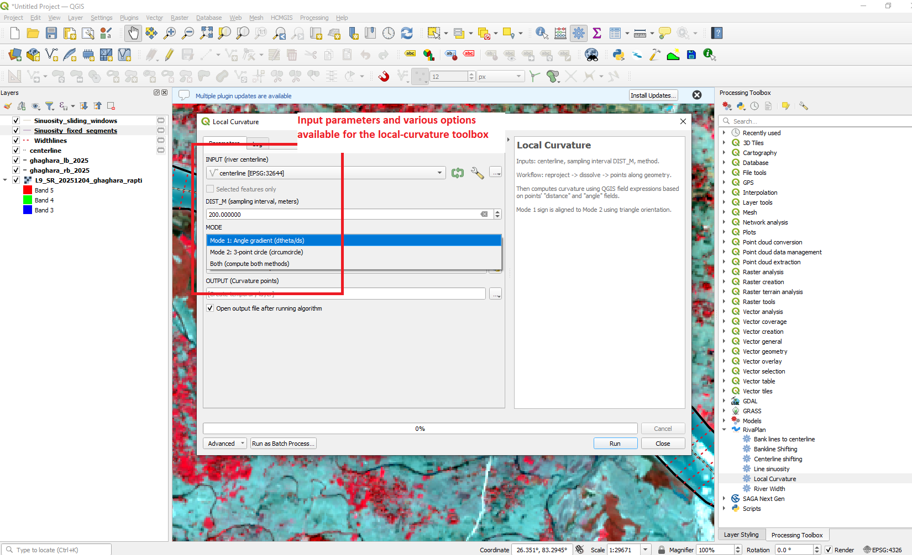
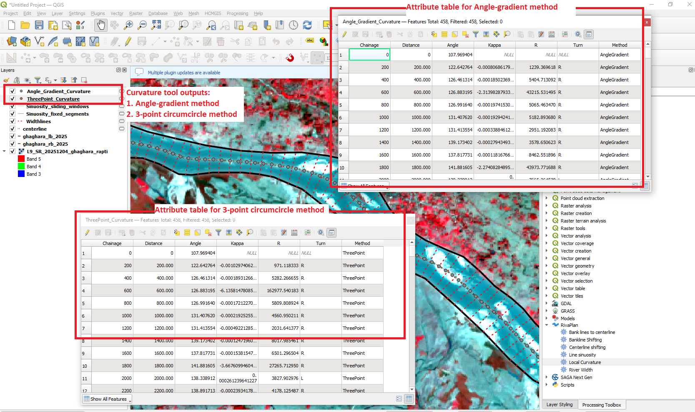

# Local Curvature

The **Local Curvature** tool quantifies local river-centerline curvature at regularly spaced sampling points.

RivaPlan provides two alternative curvature-estimation approaches:

1. **Angle-gradient method**
2. **Three-point circumcircle method**

The two methods can also be calculated simultaneously.

---

## Tool Location

In QGIS, open:

**Processing Toolbox → RivaPlan → Local Curvature**

---

## Input Parameters

| Parameter | Description |
|---|---|
| **INPUT (river centerline)** | River centerline used for curvature analysis. |
| **DIST_M (sampling interval, meters)** | Distance between consecutive sampling points. The default value is 50 m. |
| **MODE** | Selects the angle-gradient method, three-point circumcircle method, or both methods. |
| **WORKING_CRS (projected, meters)** | Projected coordinate reference system used for geometric calculations. |
| **OUTPUT (Curvature points)** | Output point layer containing local curvature measurements. |

---

## Tool Interface

  

---

## Sampling

The input centerline is first reprojected and dissolved into a continuous line.

Points are then generated along the centerline at the selected sampling interval.

Each output point represents a local position at which curvature is estimated.

---

## Mode 1: Angle Gradient

The angle-gradient approach estimates curvature from the spatial change in centerline direction between neighbouring sampling positions.

Conceptually, curvature is expressed as the change in direction with respect to distance along the centerline.

The method produces:

- local curvature magnitude,
- corresponding radius of curvature, and
- bend direction.

This mode is useful for representing continuous directional change along the river centerline.

---

## Mode 2: Three-Point Circumcircle

The three-point method uses consecutive centerline sampling points to define a circumcircle.

The local radius is derived from the circle passing through the three points, and curvature is obtained from the inverse relationship between radius and curvature.

This method provides a geometric estimate of local bend curvature.

---

## Both Methods

Selecting **Both** calculates the angle-gradient and three-point estimates for the same sampling locations.

This allows the two curvature approaches to be compared directly within one output layer.

---

## Output

The output is a point layer containing curvature measurements along the river centerline.

  

All modes contain the following basic attributes:

| Attribute | Description |
|---|---|
| **Chainage** | Distance along the river centerline. |
| **Distance** | Distance value associated with the generated sampling point. |
| **Angle** | Local centerline orientation. |

### Angle-gradient mode

Additional fields are:

| Attribute | Description |
|---|---|
| **Kappa** | Local curvature estimated using the angle-gradient method. |
| **R** | Radius of curvature. |
| **Turn** | Local bend direction. |
| **Method** | Identifies the method as `AngleGradient`. |

### Three-point mode

Additional fields are:

| Attribute | Description |
|---|---|
| **Kappa** | Local curvature estimated using the three-point method. |
| **R** | Radius of curvature. |
| **Turn** | Local bend direction. |
| **Method** | Identifies the method as `ThreePoint`. |

### Both methods

When both methods are selected, the output contains:

| Attribute | Description |
|---|---|
| **Kappa_Angle** | Curvature from the angle-gradient method. |
| **R_Angle** | Radius from the angle-gradient method. |
| **Turn_Angle** | Bend direction from the angle-gradient method. |
| **Kappa_3pt** | Curvature from the three-point circumcircle method. |
| **R_3pt** | Radius from the three-point method. |
| **Turn_3pt** | Bend direction from the three-point method. |
| **Method** | Identifies that both approaches were calculated. |

---

## Interpreting Curvature

In general:

- Larger absolute curvature values represent sharper bends.
- Smaller absolute curvature values represent gentler bends.
- A very small curvature corresponds to a large radius of curvature.
- Bend-direction information distinguishes curvature occurring toward opposite sides of the centerline.

Curvature magnitude and radius should always be interpreted together with the sampling interval and spatial resolution of the input centerline.

---

## Selecting a Sampling Interval

The sampling interval controls the spatial scale at which curvature is measured.

A smaller interval captures finer-scale centerline variations but may also be more sensitive to small geometry irregularities.

A larger interval produces a smoother, more generalized representation of river curvature.

The same interval should be used when comparing different time periods or river reaches.

---

## Input Data Recommendations

For reliable curvature estimation:

- Use a continuous and appropriately smoothed river centerline.
- Remove major geometry artefacts before processing.
- Use a projected CRS with metre-based units.
- Select a sampling interval appropriate for the scale of river bends.
- Use consistent parameters for temporal or inter-river comparisons.

---

## Notes

The default sampling interval is **50 m**.

The three available processing modes are:

- **Mode 1: Angle gradient (dtheta/ds)**
- **Mode 2: 3-point circle (circumcircle)**
- **Both (compute both methods)**

Intermediate calculations are temporary and the final curvature-point layer is returned as the primary output.