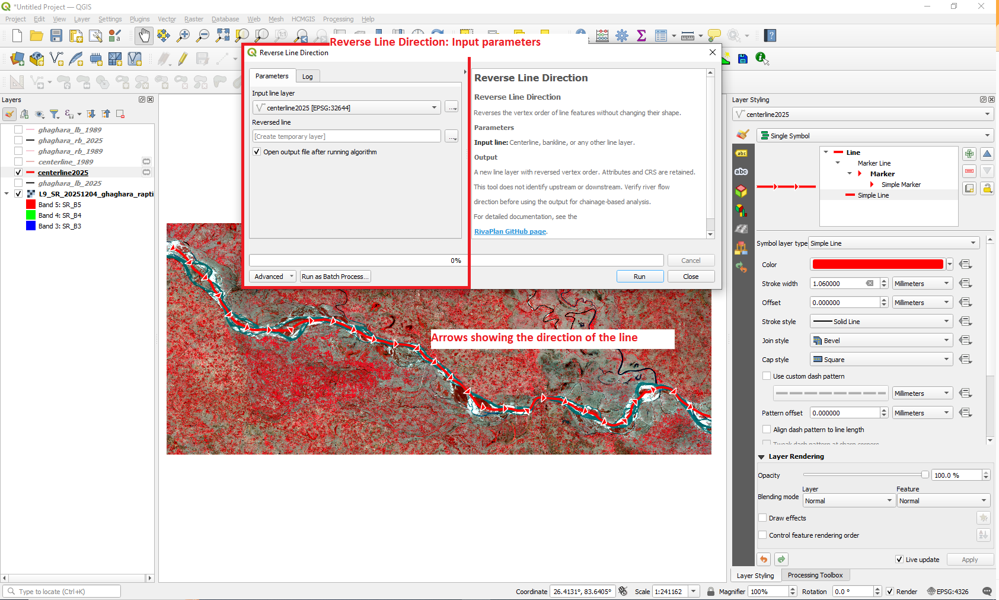
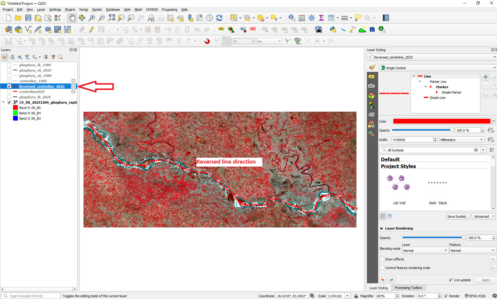

# Reverse Line Direction

The **Reverse Line Direction** tool reverses the vertex order of each input line feature without changing the feature geometry or attribute values. It is useful for making centerline orientation consistent with downstream-oriented chainage and migration analysis. **The tool does not determine river-flow direction automatically.**

## Tool location

**Processing Toolbox → RivaPlan → Reverse Line Direction**

## Input and output

| Parameter | Description |
|---|---|
| **Input line layer** | Any valid vector line layer, such as a river centerline or bankline. |
| **Reversed line** | Output line layer with reversed vertex order; geometry shape, CRS and input attributes are preserved. |

## Tool interface

## Method and use

1. Check the actual upstream and downstream ends using imagery, river knowledge or other supporting data.
2. Display direction arrows in QGIS symbology if you wish to inspect the stored vertex order.
3. Choose the input line and output destination.
4. Run the tool; inspect the reversed result and verify its orientation.
5. Use the downstream-oriented output for signed displacement, chainage or bend-direction interpretation.

## Example output

**Important:** The result follows the identical map path in reverse order. If the input and output are displayed directly on top of each other, only arrow markers or vertices can reveal the reversed direction. Line thickness itself is not a direction measure.

[Return to tool documentation](README.md)
