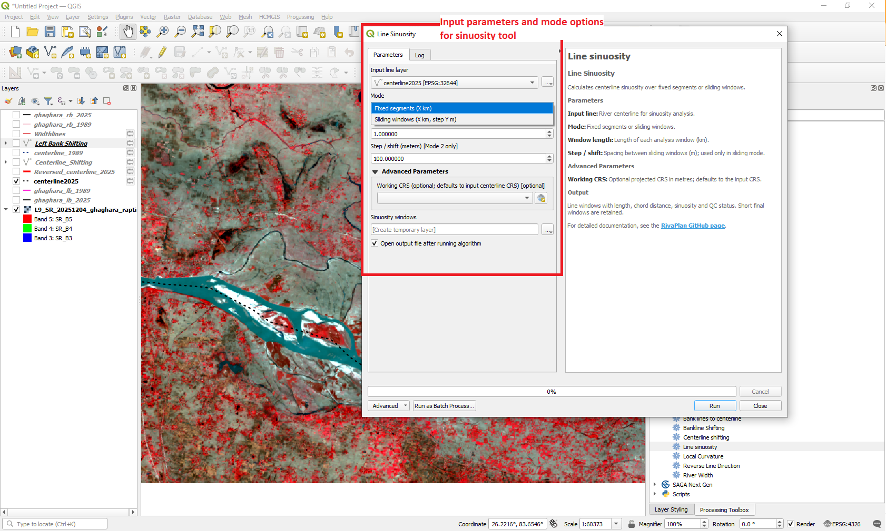
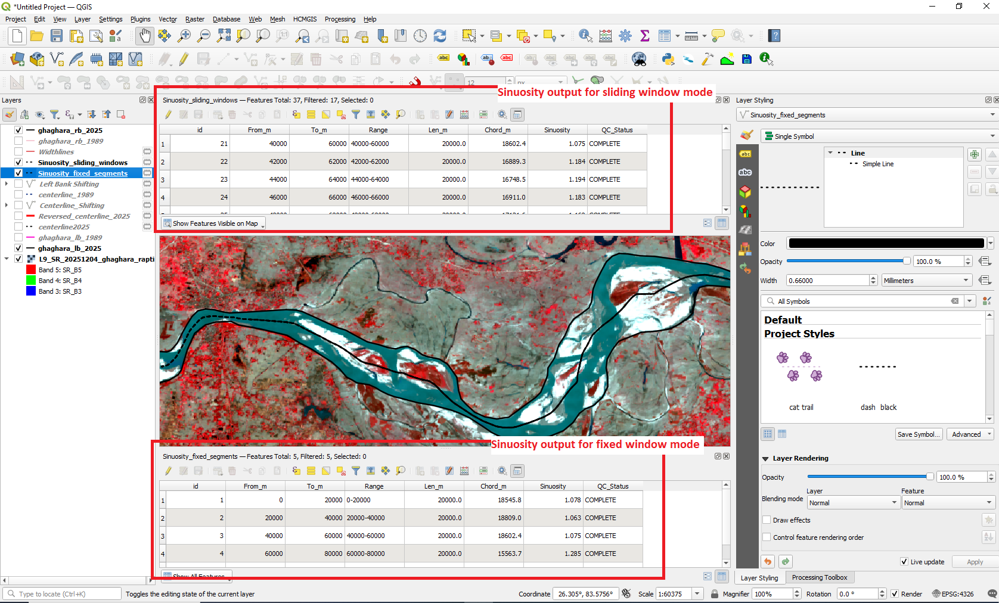

# Sinuosity

The **Line sinuosity** tool calculates river sinuosity along an input centerline using either fixed analysis segments or overlapping sliding windows.

Sinuosity expresses the ratio between the curvilinear length of a river segment and the straight-line chord distance between its endpoints.

---

## Tool Location

In QGIS, open:

**Processing Toolbox → RivaPlan → Line sinuosity**

---

## Input Parameters

| Parameter | Description |
|---|---|
| **Input line layer** | River centerline used for sinuosity analysis. |
| **Mode** | Selects either fixed segments or sliding windows. |
| **Window length (km)** | Length of each analysis window in kilometres. |
| **Step / shift (meters) [Mode 2 only]** | Distance by which consecutive sliding windows are shifted. |
| **Working CRS (projected)** | Projected coordinate reference system used for distance calculations. |
| **Sinuosity windows** | Output line layer containing the individual analysis windows and sinuosity values. |

---

## Tool Interface

  

---

## Analysis Modes

### Mode 1: Fixed segments

The river centerline is divided into consecutive non-overlapping windows of the specified length.

For example, using a 10 km window produces approximately:

- 0–10 km
- 10–20 km
- 20–30 km
- and so on.

If the remaining section at the end of the centerline is shorter than the selected window length, the final partial segment is retained.

### Mode 2: Sliding windows

A window of the specified length is moved progressively along the centerline by the selected step distance.

For example:

- Window length = `10 km`
- Step = `2000 m`

produces windows approximately corresponding to:

- 0–10 km
- 2–12 km
- 4–14 km
- 6–16 km
- and so on.

An incomplete terminal window may be retained and identified by the output `QC_Status` field. Compare only like-sized windows for consistent interpretation.

---

## Method

For each analysis window:

1. The corresponding centerline substring is extracted.

2. The curvilinear length of the substring is calculated.

3. The straight-line distance between the start and end points of the substring is calculated as the chord length.

4. Sinuosity is calculated as:

\[
\text{Sinuosity} =
\frac{\text{Curvilinear length}}
{\text{Chord length}}
\]

A value close to `1.0` represents a relatively straight channel, while progressively larger values indicate increasing channel curvature or meandering.

---

## Output

The output is a line layer containing the individual sinuosity analysis windows.

  

The output attribute table contains:

| Attribute | Description |
|---|---|
| **id** | Unique identifier for the analysis window. |
| **From_m** | Starting chainage of the window in metres. |
| **To_m** | Ending chainage of the window in metres. |
| **Range** | Text representation of the analysis range. |
| **Len_m** | Curvilinear length of the centerline substring. |
| **Chord_m** | Straight-line distance between the substring endpoints. |
| **Sinuosity** | Ratio of curvilinear length to chord length. |
| **QC_Status** | Identifies complete and incomplete windows or invalid/zero-chord cases. |

---

## Choosing an Analysis Window

The appropriate window length depends on:

- river size,
- characteristic meander wavelength,
- study-reach length,
- spatial scale of the analysis, and
- intended comparison between different rivers or time periods.

Smaller windows reveal greater local variability, while larger windows provide a more generalized representation of channel sinuosity.

For temporal comparison, the same window length and analysis mode should be used for all dates.

---

## Input Data Recommendations

For reliable sinuosity analysis:

- Use a continuous river centerline.
- Correct major geometry errors before processing.
- Use a projected CRS.
- A metre-based CRS is recommended.
- Use consistent centerline orientation and analysis settings when comparing different time periods.

---

## Notes

The default window length is **1 km**.

For sliding-window analysis, the default step is **100 m**.

Short terminal windows are retained when generated and flagged `INCOMPLETE` rather than silently treated as full-length windows. Where chord length is zero, do not interpret the resulting ratio as a valid sinuosity.

## Advanced setting and comparison guidance

- **Working CRS:** optional; defaults to input line CRS but must be projected in metres.
- **Fixed mode:** consecutive non-overlapping windows. **Sliding mode:** overlapping windows stepped by the selected shift.
- **Incomplete windows:** compare separately from full-length windows or exclude them in a consistent analysis protocol.

[Return to tool documentation](README.md)
