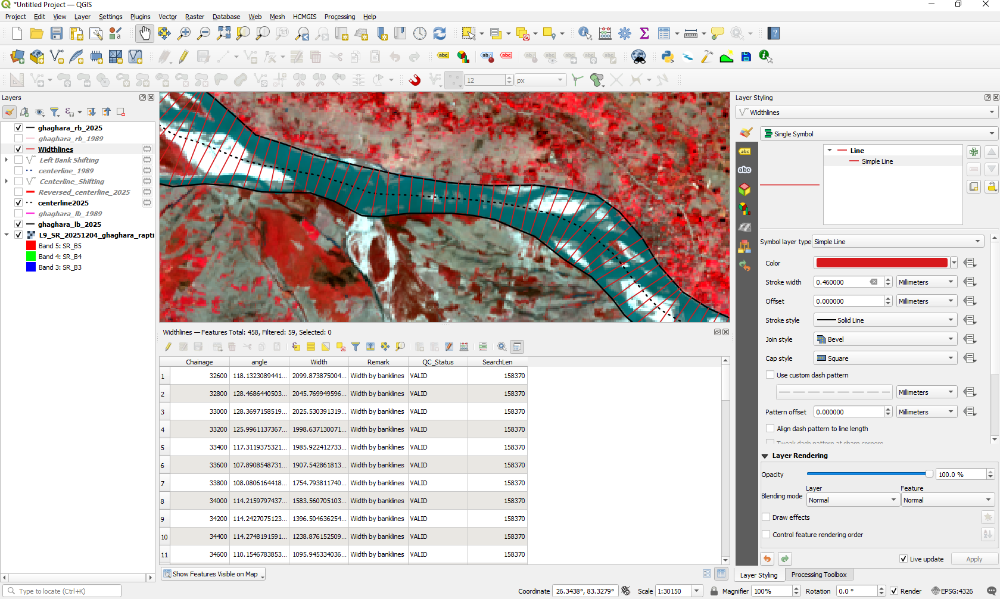

# River Width

The **River Width** tool measures channel width at regular intervals along an input river centerline.

The algorithm generates transects perpendicular to the centerline and extracts the segment bounded by the opposing river banklines.

---

## Tool Location

In QGIS, open:

**Processing Toolbox → RivaPlan → River Width**

---

## Input Parameters

| Parameter | Description |
|---|---|
| **Input Left Bank Layer** | Polyline representing one river bank. |
| **Input Right Bank Layer** | Polyline representing the opposite river bank. |
| **Input Centerline Layer** | River centerline used to position the width transects. |
| **Working CRS (advanced)** | Optional projected metre CRS; defaults to centerline CRS. |
| **Chainage Interval (m)** | Distance between consecutive width measurements along the centerline. The default value is 50 m. |
| **Transect search method** | Automatic (full input-extent diagonal **on each side**) or manual. |
| **Manual search distance on EACH side (m)** | Search limit on each side when manual mode is selected; default 500 m, only applied in manual mode. |
| **Widthlines** | Output line layer containing measured width lines or retained search transects with QC labels. |

A projected CRS in **metres is required** for measurements in metres. Verify that both banklines bound the centerline.

---

## Tool Interface

  

The user supplies the left and right banklines, the corresponding river centerline, an appropriate projected CRS, and the required chainage interval.

---

## Method

River width is calculated through the following workflow:

1. The left and right bankline layers are combined for processing.

2. The spatial extent of the banklines is used to determine a sufficiently long transect length.

3. Chainage points are generated at the specified interval along the river centerline.

4. A transect is constructed perpendicular to the centerline at each chainage point.

5. The transects are split at their intersections with the river banklines.

6. Candidate transect segments intersecting the centerline are retained.

7. The algorithm assesses bank intersections and handles limited endpoint-extension cases; measurements that cannot be reliably bounded are marked rather than interpreted as valid widths.

8. The resulting transect segments are processed to obtain the channel-width line associated with each chainage location.

9. Where multiple candidate segments occur at the same chainage, the segment nearest to the corresponding centerline chainage point is retained.

10. River width is calculated from the length of the final transect segment.

---

## Output

The output is a vector line layer containing the river-width transects.

  

Each retained transect corresponds to a measurement location along the river centerline.

Important output attributes include:

| Attribute | Description |
|---|---|
| **Chainage** | Distance of the measurement location along the centerline. |
| **Width** | Length of the final width transect. |
| **Remark** | Explains how the width was measured, or why a measurement was unsuccessful. |
| **QC_Status** | Identifies unmeasured transects with `NO_WIDTH`; inspect these rather than interpreting their length as channel width. |
| **SearchLen** | Length of the full search transect where the width could not be determined. |

---

## Chainage Interval

The **Chainage Interval** determines the spacing between consecutive river-width measurements.

For example:

- `50 m` generates width measurements approximately every 50 m.
- `100 m` generates measurements approximately every 100 m.
- Smaller intervals provide greater spatial detail but generate more transects.

The appropriate interval should be selected according to river size, centerline resolution, and the scale of the intended analysis.

---

## Input Data Recommendations

For reliable width measurements:

- Use left and right banklines representing the same river reach.
- Use a centerline corresponding to the supplied banklines.
- Ensure that the banklines and centerline are spatially aligned.
- Correct major geometry or topology errors before processing.
- Use a projected CRS.
- A CRS with metre-based units is recommended when width is required in metres.

---

## Notes

The default automatic search uses the combined input-extent diagonal on **each** side of the centerline. Alternatively, choose manual search and supply the maximum distance on **each side**. The manual distance is a search limit, **not a width measurement**.

The algorithm also applies a final filtering step to retain the most appropriate width segment for each chainage location when multiple candidate segments are generated.

Intermediate processing layers are temporary; the final **Widthlines** layer is returned as the primary output.

## Advanced settings and quality control

- **Working CRS:** optional; use an appropriate projected CRS in metres.
- **Automatic search:** searches along each half-transect using the full combined extent diagonal.
- **Manual search:** restricts how far the tool searches from the centerline on either side; choose a value large enough to reach both banks.
- **`NO_WIDTH`:** the crossing pair was not resolved. The output may retain the full search line for diagnosis, with `Width` NULL. **Do not calculate statistics from search-line length.**

[Return to tool documentation](README.md)
